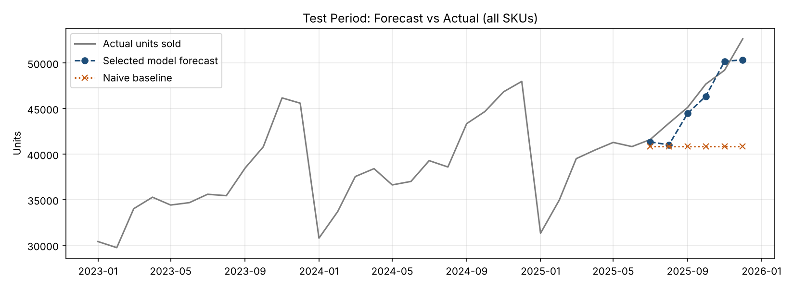
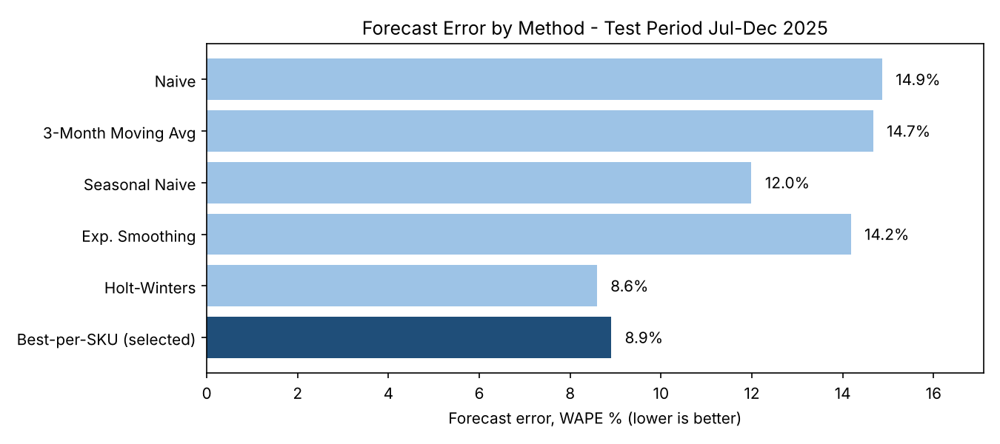

# Demand Forecasting & Inventory Planning – Packaging Distributor

Forecasting monthly demand for 15 packaging and shipping-supply SKUs, then turning the forecast into an inventory plan (safety stock and reorder points) at a 95% service level.

**Tools:** Python (pandas, NumPy, Matplotlib), Excel (SUMIFS, AVERAGEIFS, INDEX/MATCH, SUMPRODUCT, NORMSINV)

## Results

| Metric | Result |
|---|---|
| Forecast accuracy (1 – WAPE), Jul–Dec 2025 test period | **91.1%** |
| Forecast error vs. naive baseline | **reduced 40%** (WAPE 14.9% → 8.9%) |
| Safety stock needed at 95% service level | **$63.3K**, which is **$16.8K (21%) less** than with naive forecasting |
| 6-month forecast (Jan–Jun 2026) | 241K units across 15 SKUs |

## Approach

1. **Data:** 36 months (Jan 2023 – Dec 2025) of *simulated* monthly sales for 15 SKUs (boxes, tape, mailers, stretch film, labels, protective packaging). The data has 7–8% yearly growth and a Q4 holiday-shipping peak. Each SKU has a unit cost and a supplier lead time.
2. **Five forecasting methods:** Naive, 3-month moving average, seasonal naive, simple exponential smoothing, and Holt-Winters (level + trend + seasonality, with parameters tuned by grid search).
3. **Choosing a method without overfitting:**
   - **Validation:** each method was trained on 2023–2024 and scored on Jan–Jun 2025. The best method was chosen for each SKU.
   - **Test:** the chosen methods were retrained through Jun 2025 and scored on Jul–Dec 2025. The selection step never saw this period.
4. **Inventory plan:**
   - Safety stock = Z × forecast-error RMSE × √(lead time in months)
   - Reorder point = average monthly forecast × lead time + safety stock
   - The service level is an input in the Excel model, so the whole plan updates when you change it.

## Files

| File | What it is |
|---|---|
| `Demand_Forecasting_Project.ipynb` | Full project in one notebook. Runs in Google Colab with no setup. |
| `generate_data.py` | Creates the simulated sales dataset |
| `forecast_project.py` | Analysis: exploration, models, validation/test, forecast, inventory plan |
| `build_excel.py` | Builds the Excel dashboard |
| `outputs/Demand_Forecasting_Inventory_Plan.xlsx` | Dashboard, inventory plan, forecast, model comparison, backtest, data |

**Run locally:** `python generate_data.py && python forecast_project.py && python build_excel.py`

*Note: the sales data is simulated for learning purposes and doesn't represent any real company.*
